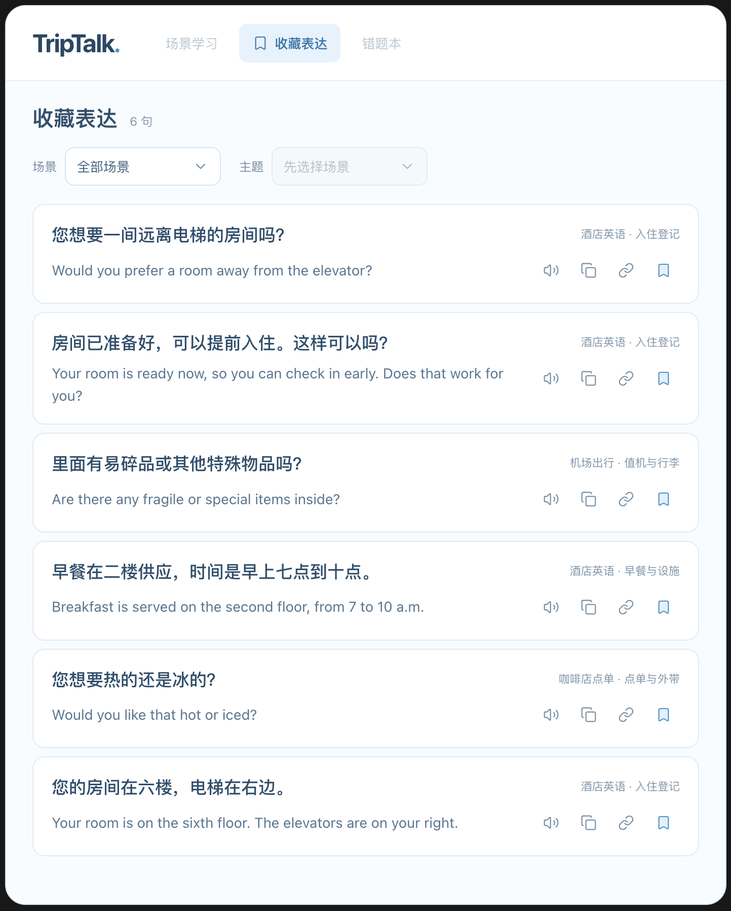

# 交互稿与视觉资产索引

视觉方向已选奶蓝版。产品行为以 [产品细则](../docs/product.md) 为准，阶段顺序以 [开发计划](../docs/development-plan.md) 为准。

视觉规则更新：2026-11-23。P1 已扩展动态主题目录、三档难度和课程安排弹窗；P1.5 SQLite 不改页面布局，P1.6 已增加录音输入与句子点播，P2 独立自由聊天、P3 完整课程/复习待实现。阶段状态以开发节奏为准，自动化视觉回归平台后置。

## 最新视觉总览（2026-11-09）

[四页奶蓝交互稿 v2](references/triptalk-four-pages-blue-v2.png)：保留简约视觉方向，包含首次/再次首页、对话、复习。旧图的固定数字和未开放场景仅为历史示意；本次未重绘 PNG，现行布局调整以下文为准。

保留大幅 Jane、奶蓝背景与白色对话气泡，各页导航与人物区域位置一致。参考回答点击填入后可编辑，再由用户发送；图中为辅助展开状态。此图是静态视觉参考，不是已实现页面；进度、题目和错题均为示例，实际任务与阶段范围仍以产品文档为准。

## 页面与固定布局

四张稿是三个页面：首页的首次/续学两种状态、对话练习页、复习与错题页。主题结束状态已实现；总览 PNG 未完整反映现行页面。

- 顶部固定布局：TripTalk +「场景学习 / 复习与错题」；错题与收藏在复习页内切换，不另设一级导航。
- 顶部下方为 Jane 陪伴横幅：左侧半身 Jane，右侧白色气泡。各页人物位置与区域尺寸稳定，不改成小头像侧栏；练习时气泡展示当前前台问题，首页与复习页展示简短引导。
- 横幅下方为白色内容区：随页面切换，保留一致的边距、宽度与圆角。Jane 始终可见，不在每条消息重复大头像。
- 删除常驻心情选择、天气卡、重复欢迎标题、装饰流程条与多余标签。天气、精细动画不在当前实现范围；录音输入与句子点播见下方 P1.6 说明。

| 页面 / 状态 | 主内容与操作 | 阶段 |
| --- | --- | --- |
| 首次首页 | 欢迎、场景卡、三档难度；未初始化进度留白，点击「开始场景」；生成成功自动打开课程安排，可「立即学习」 | P1 |
| 续学首页 | Welcome back、当前主题与场景进度、「继续学习」；恢复会话和反馈状态 | P1 |
| 对话练习 | 当前任务、历史对话、文字输入、提示、发送；通过后自动问下一题 | P1 |
| 复习与错题 |「错题本 / 收藏表达」切换，题目、原回答、再次输入、参考表达、检查回答 | P3 |

首次欢迎示例：Hello，我是 Jane！很高兴认识你，让我们一起开始旅行英语学习吧。仅访问或生成目录不误显示续学；必须有未完成会话才显示「继续学习」。

### 本次首页精简与动态目录

- 首页气泡身份标签为「Jane · 你的旅行搭子」，采用正常字距、13px 蓝灰文字；学习区仅保留「把想去的远方，聊成下一站。」主标题。删除两处英文装饰标语及右侧重复陪练提示，不保留空行；窄屏可按逗号分成两段，保持正常横幅与内容区间距。
- 按用户红框删除“文字对话 · A1–A2”和首页整条本地存储/云端发送提示。仅移除页面文案，隐私和虚构身份约束仍在产品/接入文档、Agent 指令中保留。
- 场景卡上方增加简单/中等/高级轻量分段按钮，默认中等；已有对话时注明本次难度不变，新主题才使用新偏好。
- 未生成目录及生成中不展示数字/进度条/虚假主题，仅保留空白高度；按钮显示准备状态，禁止重复提交。
- 首页不再横排展示主题目录。已初始化场景的名称右侧显示 ⓘ，用于重开课程安排；主卡只保留当前主题、进度与学习按钮。四个固定场景卡可进入。
- 主场景卡不展示英文装饰标题或「本主题已完成几个交流目标」；按场景名、当前主题/续学提示、场景总体进度分层。ⓘ 使用 14px 图标与 24px 点击区，标题间距 4px，不再复用弹窗关闭按钮的 44px 尺寸；对话页仍保留本主题目标进度。
- 主题完成后返回所属场景，主卡指向下一未完成主题。全完成可主动再练，不能默认重复入住。

### 课程安排弹窗（2026-11-17 确认版）

- 奶蓝浅渐变头部、白色圆角卡片、轻遮罩。头部只有「场景名 · 课程安排」和一行主题数/完成数、难度、每主题 8–15 问；删除英文装饰标题、Jane 重复说明和「课程已准备好」。
- 正文纵向编号排列真实主题，附范围首句的简短摘要；进度使用「待学习 / 进行中 / 已完成」，不再写「下一主题」，不铺满锁图标。目录只展示，不提供跳课入口。
- 底部仅「关闭」和学习主按钮，不再重复「从某主题开始」。按钮状态、自动打开时机与失败恢复统一见 [产品细则：进入课程](../docs/product.md#41-进入课程)。
- 弹窗限制高度，正文滚动，标题及底部按钮保持可见；支持 Esc、键盘焦点约束、关闭后恢复焦点。提交期间禁用重复提交与关闭，背景不可交互或滚动。

## 自定义场景与全部目录（A 版）

- 首页探索区采用四个等宽卡位：三个其他场景保留原插画，第四格固定浅奶蓝自定义入口与圆底加号；640px 以下为两列，入口始终在末格。总场景超过四个显示「查看全部（总数）」；不以横向滚动隐藏创建入口。
- 创建采用居中原生模态，600px 最大宽、22px 圆角、奶白底与浅蓝边框，背景轻遮罩；一个描述输入框、快捷示例、名称预览、难度说明、创建按钮。描述首句作为名称，无额外模型调用。创建后关闭弹窗，新场景显示在探索列表首位，不切换主卡片、不直接生成课程；自定义场景按新到旧置前，内置场景顺序不变，全部目录采用相同展示顺序。
- 全部目录共用模态：名称搜索、全部/内置/我的筛选、当前学习标记；桌面两列，窄屏一列，长内容只滚动弹窗正文。选择失败留在弹窗并就地提示。
- 提交期间禁止关闭/重复点击，失败保留输入；未知结果只重试原请求，关闭后再次打开显示「继续创建场景」。Esc 关闭与焦点恢复遵循原生模态行为。不新增场景编辑/删除/排序功能。

## 收藏表达（2026-11-25 确认版）

顶部独立「收藏表达」入口；无头图、无搜索、无分组折叠。中文 17px/600，英文 14px/1.7 蓝灰色，白色圆角卡片配浅蓝边框。场景/主题置右上，朗读/复制/来源/收藏置右下；窄屏自然重排，保留全部句子和可触控按钮。缺失译文明确说明，教学解释单独折叠。完整交互与技术边界见 [收藏方案](../docs/favorites.md)。

原对话 Jane 句子和推荐表达使用真实收藏按钮，用户原始回答不提供收藏；旧文中“即将开放占位”由本节取代。

## 答题区交互

- 多行输入框始终可找到，位于答题面板下部；桌面长对话仅历史区滚动，避免整页把输入框推走。窄屏键盘打开时仍能看到输入与发送。
- 提示按需展开；中文作答任务默认显示；英文关键词、句式与完整参考默认隐藏，点击「给点提示」才展开。截图是参考回答已展开的状态，不要求每轮常驻。
- 「给点提示」仅更新输入框上方的辅助区，不新增用户/Jane 气泡或教学说明。按当前题目汇总各级最新提示，已获取的关键词与句式同时保留，换题不携带旧提示；不自动请求未获取的内容。
- 采用紧凑引导版：Jane 头图只保留英文问题，桌面高度最多 142px；消息区占剩余空间。辅助区左右内缩 16px，与输入框正文对齐，上下内距 4px/2px、距输入框 12px。以「本轮目标 / 关键词 / 句式」左侧 52px 标签列对齐，列间距 16px（窄屏 10px）；不加星形图标、关键词卡底或边框。标签 12px/500 蓝灰 #647D91，目标正文 14px 深蓝 #294E6B，提示正文 13px 蓝灰 #506D85、行高 1.7；不按分隔符拆分模型原文。
- 完整参考按需展开为浅蓝 #F0F8FE、12px 圆角的单层块，不再嵌套白色卡片。已有参考可通过「看参考表达 / 收起参考表达」切换，无重复模型请求；首次仍沿关键词 → 句式 → 参考的求助流程。长内容集中在辅助区限高滚动，避免挤掉输入和发送入口。
- 输入区采用确认的 C 版一体布局：白色输入与底部操作共用 18px 圆角浅蓝边框；左侧轻量提示入口，右侧麦克风与蓝色渐变圆形向上箭头。桌面按钮 38px，触屏至少 44px；发送的可访问名称/悬浮文案保留，待核对状态用回转图标。
- 移除常驻「解释词句」入口，但保留后端解释能力与已存解释记录；旧草稿若恢复在解释模式，显示「返回作答」以便退出。关键词标题简化为「关键词」，模型正文不重复标题；已有关键词正文只在展示时去掉开头明确的「关键词：/关键词提示：」，不修改保存内容。
- 参考回答文字可自由选中，旁边单独提供「填入输入框」，避免双击选词时误填草稿。确认填入后收起参考、保留关键词和句式，聚焦输入框，可修改后手动发送；已有不同草稿时先确认替换，取消不改变草稿或展开状态。
- 示例回答来源于当前任务，不能推进任务；使用辅助与独立作答可分别记录，但都允许完成练习。
- 英文角色台词与教学反馈分开呈现；轻微错误不强制反复重写。通过后反馈留在原回答下面，自动追加下一问，输入框切换中文任务；最后一问通过后直接展示结束语。不再逐题显示「继续 / 完成本主题」，程序校验后才推进。
- 教学反馈按确认稿分层：正确、允许继续且无改写时保留轻量点赞；已通过的表达建议采用浅蓝卡（#F0F8FF，边框 #C8E1F2），标题「表达小建议」，不显示右侧「可以继续」。回答未通过且 verdict 为 needs_correction/uncertain 时使用暖杏卡（#FFF7ED，边框 #EFD7B7），线性铅笔配「再试一次」，区别于系统重试；解释/其他求助不标成答错，使用蓝色「学习提示」。系统故障仍使用独立警示，不改变教学推进。
- 反馈卡圆角 12px、内边距 18px 20px；标题前 28px 圆角图标底，正文缩进 38px 与标题对齐。正文/推荐英文 14px，推荐英文 600 字重、上下间隔 12px，解释 13px；480px 以下内边距 14px、正文取消缩进。无左侧竖线，不增加改写按钮或新数据字段。
- 含义错误、关键信息缺失、求助和解释停留当前题。只有处于 awaiting_continue 的记录显示一次「恢复对话 / 查看完成结果」，不修改历史；正常回答通过自动推进。
- 普通 Enter 发送，Shift + Enter 换行，也可点击发送按钮；不展示快捷键提示文字。中文输入法选词和长按 Enter 不触发发送；空白、请求中、同步中或存在待确认操作时不发送。
- 失败保留原文并允许重试，不增加错误次数、不显示虚假完成。切换辅助面板不丢草稿；退出/保存语义见产品细则。
- 单条对话采用简约圆角气泡：Jane 为浅灰底、用户为奶蓝底并右对齐；不重复显示作者标签，作者信息仍提供给屏幕阅读器。Jane 气泡下方靠右提供朗读、复制和真实收藏，用户气泡只保留复制；推荐表达旁可独立收藏。未提供真实时间字段，不补造时间。复制成功短暂切为勾选，已收藏图标使用浅蓝填充。
- 删除情境/角色设定展开行、重复题号和底部常驻保存说明，保留顶部主题进度、中文作答任务、发送状态与异常恢复。仅移除显示，虚构身份的安全要求仍由课程及 Agent 保证。
- 对话工具栏不展示「本次难度」小字，难度配置及出题逻辑不变。「返回首页」使用 11px 蓝灰文字、13px 箭头与轻量悬浮底色，保留至少 32px 高的点击区；窄屏缩写为「返回」，无障碍名称仍为「返回首页」。
- 仅历史对话消息提供复制图标；输入框下方、Jane 头图和教学/参考提示不放复制图标。阅读文字与输入框显式允许浏览器原生选词/拖选，选区使用奶蓝底深色文字；双击不自动写入剪贴板。复制受限时提示手动选中复制。
- 返回确认使用奶蓝小卡片与轻遮罩，标题「先休息一下？」、简短保存说明，以及「继续练习 / 返回首页」。支持 Esc、焦点约束和关闭后恢复焦点，默认聚焦继续练习；不再使用 window.confirm 处理页面返回。
- 发送后立即出现右侧奶蓝用户气泡，左侧小转圈、下方轻量等待状态；失败改为左侧刷新图标和一行原因，详情折叠。不使用常驻橙色异常框或「放弃重试并编辑」弹窗。主按钮随状态显示发送/重试/核对状态；求助和恢复失败就近展示，不混入用户消息。具体恢复规则见产品细则第 5 节。

## 复习与异常状态

- 主题完成卡仅保留完成标识、主题标题、Jane 结束语和操作按钮；不再显示「返回场景查看进度、选择难度并开始下一主题」的重复说明。
- 先呈现表达任务，让用户作答；「查看参考表达」只揭示示例，不标记通过；「检查回答」才进入真实评估。接受正确变体，不做逐字匹配。
- 尚无错题/收藏时展示空状态和返回学习入口，不填充演示条目。未开发复习能力时明确说明尚未开放。
- P1 主题结束后 Jane 给出基于实际表现的鼓励/幽默结尾，P2 起提供「继续任务：下一主题」和「和 Jane 自由聊聊」。P1 自由聊天入口标记尚未开放。无可用下一主题时改为复习或返回场景。自由聊天有明确模式标签，隐藏训练进度与作答任务、独立保存，并提供返回训练入口。
- 整课完成后提供复习、重练与可用的新场景；首发没有新课时不提供无效的新场景按钮。P1/P2 只称本段练习完成，P3 才使用整课完成文案。
- 组件必须覆盖发送中、请求失败、保存失败、历史加载失败、无记录和图片加载失败。图片失败仍保留 Jane 名称与文字引导。

## 视觉稿与实现规则的边界

视觉稿的 0/4、1/4 是旧示例。新场景生成 3–8 主题，历史课程按实际保存的目录展示；每主题生成 8–15 问计划。场景显示已完成主题数 / 保存目录主题数，主题显示已完成计划项 / 本次计划项数；生成前留白。计划与规则见 [Agent 设计](../docs/agent-design.md)。

现有四页 PNG 保留视觉风格参考，尚未重绘中文作答任务、主题选择、结束双入口与自由聊天状态；开发以本次文字规范为准，不照抄旧图进度或默认展开答案。

图中的 When breakfast? 在可理解语境下属于可接受表达，不应因缺词机械计入错题；可作为自然表达建议或收藏。错题进入条件按产品和 Agent 规范，不按图片示例判错。

## 早期参考稿（保留）

| 稿件 | 使用条件 | 开发重点 |
| --- | --- | --- |
| [首次来访](references/first-visit-blue.png) | 尚未完成引导 | Jane 欢迎、场景卡、开始入口；无强制注册 |
| [学习进行中/续学](references/resume-lesson-blue.png) | 有未完成课程 | 真实场景、阶段、断点；“继续 XX” |
| [上一场景完成](references/completed-lesson-blue.png) | P3 无未完成课且有整课完成记录 | 新场景、复习、重练；新课不可用时正确降级 |

P1 练习结束只称本主题完成，可查看记录、再练一次或返回场景；P2 开放自由聊天，不套用整课完成文案。

这些是视觉交互参考，不是可点击原型或逐页完整规格。练习与复习页的整体视觉已补入上方四页总览；错误、加载、空状态、设置和窄屏稿仍需在对应开发阶段细化。可采用已有 tokens 与产品规则，不需要等全站高保真完成才做酒店闭环。

## 问题中文释义（已实现）

2026-11-26：原回答与修正版也支持对应中文气泡。聊天操作栏桌面悬停消息／工具栏或键盘焦点时出现，触屏直接可用；保留占位，气泡与栏间距 4px。图标按钮固定尺寸、顶端对齐，按下不位移，键盘焦点使用 2px 细框及 1px 偏移。保存／错误状态不隐藏。已收藏为 #1677b5 实心书签搭配 #dceffc 底色，与未收藏线框明确区分；待回复收藏不可用，悬浮说明「回复完成后可收藏」。

问题中文释义已实现为点击式奶蓝小气泡：默认不增加图标或常驻文字，浮层不挤动布局、避开视口边界并允许拖选；10 秒自动消失，点击中文气泡或再次点击英文关闭并取消计时。详情见 [产品角色练习](../docs/product.md#44-角色练习)。该能力独立于录音和句子点播。

## 录音输入与句子播放（P1.6）

不新增页面、不改 Jane 与历史对话的固定布局；在输入区加入小型麦克风按钮，沿用奶蓝与现有线性图标，不增加大面积状态色。

| 状态 | 输入区表现 |
| --- | --- |
| 待机 | 麦克风入口有可访问名称与悬浮提示，文字输入照常使用 |
| 录制中 | 局部显示计时、「结束并识别」「取消」，不堆叠说明卡 |
| 识别中 | 原位置显示识别状态与取消；防止回车误发草稿或重复录音 |
| 识别完成 | 转写作为可编辑文字，恢复原发送操作，不另建确认页面 |
| 失败 | 就近显示具体原因和重试/文字输入入口，不改变学习进度 |

录音入口位于发送按钮左侧，为 40px 奶蓝风格图标按钮：待机显示麦克风，申请权限/准备设备和识别时原位显示 loading，实际录音后切换双竖线暂停样式图标。点击双竖线是停止并识别，不支持暂停续录；不再放独立停止按钮或常驻「录音输入」文字，可访问名称及悬浮提示保留。计时/错误/取消入口在操作栏上方按需出现。转写追加到最新草稿，不替换；超长时显示完整可选文字和「追加到草稿/关闭」。首次使用复用小型确认弹窗说明云端识别。

Jane 和已保存的用户消息下方的播放图标与复制、收藏并排，15px 线性喇叭、桌面 28px 点击区域（触屏至少 44px）；播放时变为停止图标和浅蓝选中态，尺寸位置不变。不在头图重复放图标，不改变点击释义或原生选词。播放失败使用就近短提示，不新增底部异常大卡。

业务规则与限制见 [产品第 4.8 节](../docs/product.md#48-录音输入与句子播放p16)，验证与真实设备待办以开发节奏为准。

## 角色与素材

- [Jane 透明背景设定图](assets/jane-character-sheet.png)：一个角色的三视图和多表情参考；不是多个角色，不是分层源稿或已完成动画。
- [P1 单人 Jane](../public/jane/jane-welcome-v1.png)：实际网页使用的透明 PNG，内置 ImageGen 基于设定图与奶蓝稿生成；保留原始设定图不覆盖。[生成提示词](assets/jane-welcome-v1.prompt.txt)。
- [单动作动画提示词模板](jane-animation-template.txt)：后续用于欢迎、待机、讲解、庆祝。
- [原始角色生成提示词](jane-character-generation-prompt.txt)：追溯设定，不是运行时 Agent 的系统指令。

固定识别点：黑棕色高马尾、齐刘海、黑框眼镜、奶蓝开衫、奶白内搭。保持成年助教的温和气质；全身默认深蓝直筒裤、浅色运动鞋，沿用现有设定，后续可改。面部比例和眼镜以设定图为准，不随情绪换脸。P1 准备单独的静态 Jane 展示素材；可以从参考视图裁出合适单人图，但不得把整张设定图缩成九宫格头像。真实动作素材尚未交付，精细动画列 P4。

## 建议初始视觉 tokens

以下为开发起点，不是从截图逐像素提取的最终数值；实现时在真实组件上验证对比度。

| token | 建议值 | 用途 |
| --- | --- | --- |
| background | `#F7FAFD` | 页面背景 |
| surface | `#FFFFFF` | 内容卡 |
| primary-soft | `#DCEEFF` | 奶蓝区域 |
| primary | `#326995` | 主按钮、可读交互文字 |
| text | `#243B53` | 正文 |
| text-muted | `#52677C` | 次级文案 |
| 教学提示 | 浅蓝表达建议、暖杏重答卡、轻量点赞 | 不再使用绿色反馈底，不按系统故障呈现语言错误 |
| border | `#D8E5EF` | 卡片边框 |

卡片圆角建议 20px，按钮 12–16px，间距以 4/8px 网格；正文 16px 起。奶蓝浅色用于背景，不把低对比浅蓝当白底小字。主要操作满足键盘和触控使用。

桌面采用顶部 Jane + 气泡横幅、下方内容区；窄屏将横幅收为始终可见的紧凑 Jane 与短引导，不完全隐藏人物。验证约 390px 与 1440px 布局，无横向滚动；最终断点由内容决定。静态/减少动效模式必须可用。任何截图上的进度、天气、错题数量均为示例，不硬编码到正式页面。
