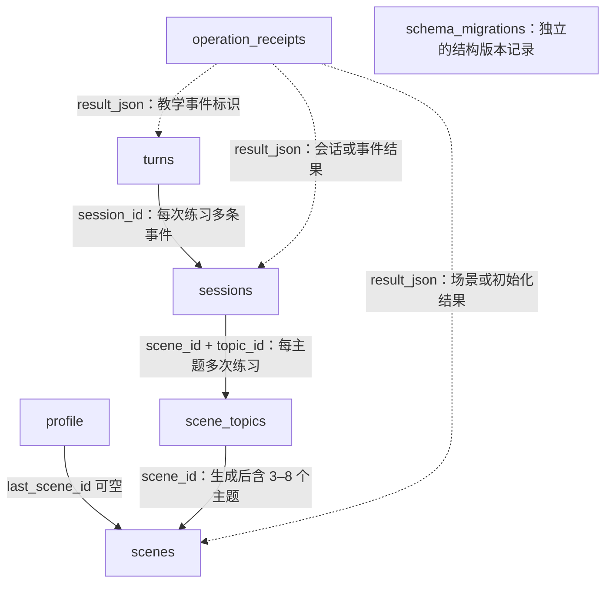

# SQLite 接入导读与迁移方案

2026-11-24 · SQLite 已接入并获用户验收。旧 JSON 转换命令与契约已退役；新安装、备份和当前数据兼容继续保留。第 8 节的 JSON 转换流程仅记录已完成的历史，不是当前操作指引。

本版决定：内置/自定义场景及其课程生成信息统一存入 `scenes`，不再独立建 `scene_plans`；Jane 实际提问与回答等统一存入 `turns`；新表不保存 `action=continue`；所有需要请求去重的业务共用 `operation_receipts`。共 **6 张业务表 + 1 张结构版本表**。这替代上一版独立 `session_questions`、专用 `creation_requests` 和继续保留 continue 事件的方案，不额外增加另一张“统一事件表”。

面向有 React/TypeScript 经验、后端存储经验较少的开发者。本文先建立理解框架，再推导方案，而不是先给一批表名让你记住。这里的“框架”是思考方式，不是要引入新的后端框架。

阅读顺序：

1. 第 1–2 节：后端、数据库、内存各做什么，一次请求如何保存下来。
2. 第 3 节：设计表时用哪些原则作判断。
3. 第 4 节：**方案前审视**——先从实际代码、读写需求和产品方向推导边界。
4. 第 5–6 节：具体表结构、技术选择及代码调整；列级细节可第二遍再读。
5. 第 7 节：**方案后复核**——用当前流程和未来需求检查设计，说明取舍与限制。
6. 第 8–10 节：迁移、回归和交付顺序。

业务字段含义仍以 [数据契约](data-contracts.md) 为准；本文负责知识导读、SQLite 物理设计与取舍，不复制整份业务字典。已落地字段见 [001_initial.sql](../src/server/storage/migrations/001_initial.sql)，代码进度以开发节奏为准；验收状态以开发节奏为准。

## 1. 先建立后端存储的整体框架

### 1.1 后端不等于数据库

后端是运行在服务器环境里的程序：接收请求、检查规则、调用外部服务、读写数据、组织响应。数据库只是其中负责可靠保存与查询数据的部分。

TripTalk 的“服务器”目前就是你本机运行 Next.js 的 Node 进程，不是一定要另外租一台机器。浏览器与 Node 即使在同一台电脑上，也是不同运行环境；浏览器里的 globalThis 不能查看 Node 的全局变量。

```text
浏览器：组件 / Hook / 草稿
       │ HTTP 请求 / 响应
       ▼
Next.js 服务端
  Route Handler：接收和校验请求
       ▼
  Service：编排需要多个步骤的业务 ──→ 模型服务：生成候选内容
       ▼
  Repository：按业务意图查询、校验提交、保存
       ▼
  存储工具 / 数据库驱动：执行文件操作或 SQL
       ▼
磁盘：SQLite 文件（旧 JSON 已留档）
```

这不是每次都必须经过的层数。修改偏好很简单，当前 preferences 路由直接调用仓库；提交回答涉及模型与任务推进，才由 turn 服务编排。Next.js 服务端页面也能直接读仓库，例如首页 page.tsx 为恢复 lastSceneId 读取 profile，不必绕一遍本机 HTTP。

**模型生成结果、页面出现消息、服务端保存成功，是三件事。** 模型不会直接把数据写到我们的磁盘；必须通过程序校验和仓库提交。

### 1.2 同一个业务数据，为什么会有不同“形状”

| 形状 | TripTalk 例子 | 用途 |
| --- | --- | --- |
| 请求对象 | requestId、expectedRevision、action、text | 表达“我要做什么”，不是让浏览器提交整份数据库 |
| 业务对象 | Session，含计划、当前位置、历史 | 让教学与状态转换代码方便工作 |
| 持久化结构 | SQLite 多张关联表 | 可靠保存、按条件查找、约束关联 |
| 页面 DTO | HomeView、SessionView | 只给页面需要的数据，不暴露内部参考答案和诊断信息 |

DTO 可以理解为“专门给页面的响应对象”。它不必和数据库行一一对应。`views.ts` 已经在做这层挑选与组装；此次统一事件会调整历史展示契约，但页面内容、会话 URL、输入与重试体验必须保持。不能把“换数据库”误认为所有客户端代码都不用改。

同理，**一个页面不等于一张表，一个 TypeScript 类型不必对应一张表，一张表也不必对应一个仓库文件。** 数据表围绕信息关系设计，组件围绕展示设计，仓库围绕业务读写边界设计。

### 1.3 哪份数据说了算

| 位置 | 保存什么 | 能否作为已提交学习记录的依据 |
| --- | --- | --- |
| React state | 当前页面视图、输入状态 | 不能；卸载后可能重新加载 |
| 浏览器 sessionStorage | 草稿、未确认请求的备忘 | 不能；它帮助恢复请求，不决定学习进度 |
| Node 内存/globalThis | 连接、仓库实例、在途锁等运行对象 | 不能；重启后会重建 |
| 当前 SQLite | 已提交的计划、会话、事件与偏好 | 能；这是本机学习记录的权威来源 |

“缓存”是为减少重复工作保留的可重建副本，不应是唯一记录。当前 getStore 缓存的是操作入口，不是在全局对象里永久缓存整份最新学习数据。

### 1.4 用一次发送来理解读写和失败

先读当前会话 → 检查重复请求与版本 → 调用模型 → 检查反馈、生成候选会话 → 仓库重新检查并提交 → 返回 SessionView → 页面确认消息已保存。

两个重要区别：

- 模型返回成功，但保存失败：这次学习更新没有成功，不能推进页面进度。
- 保存成功，但 HTTP 响应丢失：数据可能已经在磁盘上，不能立即生成新操作重复保存；要按原 requestId 核对。

因此后端工作不只是“把对象写到文件”。它还要明确谁能改、何时能改、哪些修改必须一起成功，以及失败后如何确认事实。

## 2. 数据库的基础概念

### 2.1 数据库仍在磁盘上，不是另一份全局变量

SQLite 是嵌入进 Node 进程的数据库引擎，不需要额外启动 MySQL 那样的数据库服务。`.sqlite` 文件保存正式数据；浏览器不能直接访问它，仍通过现有 `/api` 请求。

```text
迁移前：页面 → API → service → repository → JsonFile → 场景 JSON
之后：页面 → API → service → repository → SQLite 连接 → 数据库文件
```

数据库引擎负责执行查询、维护索引、检查约束和提交事务；驱动是 TypeScript 调用引擎的入口；SQL 是描述读写意图的语言。ORM 是在 SQL 上再包装对象映射的可选工具，不是使用数据库的前提。本项目已有仓库，是否加 ORM 应看能否减少真实复杂度，而不是“后端都需要”。

### 2.2 表、行、列，以及主键和外键

可以先把表理解为有规则的二维集合：

| 概念 | 本项目例子 | 解决的问题 |
| --- | --- | --- |
| 表 table | `sessions` 保存所有练习会话 | 不必扫描各场景文件找会话 |
| 行 row | 一条酒店入住会话 | 对应一个业务实体 |
| 列 column | `id`、`scene_id`、`status` | 按条件查询和更新 |
| 主键 PRIMARY KEY | `sessions.id` | 唯一标识某段会话；保留现有字符串 ID |
| 复合主键 | `scene_topics(scene_id, topic_id)` | 不同场景都可能有 `topic-1`，不能只按 topicId 定位 |
| 外键 FOREIGN KEY | 会话的场景/主题引用目录中的主题 | 防止生成没有归属的记录 |
| 唯一约束 UNIQUE | 同一操作作用域的同一个 requestId 只能有一份回执 | 防止重复提交业务操作，不限制一次请求只能产生一条事件 |
| 索引 INDEX | 按 scene_id/status/updated_at 查会话 | 提高定位效率；不是另一份业务进度 |

外键检查需要在**每个连接**上明确启用，并检查实际生效，不能只在 SQL 中写了 REFERENCES 就认为已经保护。参见 [SQLite 外键说明](https://www.sqlite.org/foreignkeys.html)。

还要理解“关系数量”：一个场景有多个主题，一个主题可以有多段重练会话，一段会话有多条事件，都是一对多。不能因首次学习每主题只有一段会话，就把主题与会话设计成永久一对一。

JOIN 是按键把相关行组合起来查询，不是把两张表合并保存。例如用 sessionId 将会话与它的事件关联，仍各自保存自己的信息。

### 2.3 SQL 是描述“取哪些数据”，不是手工拼文件

常见的 CRUD 就是新增 INSERT、读取 SELECT、修改 UPDATE、删除 DELETE。本项目很多历史只允许追加，不因为数据库提供 DELETE/UPDATE 就对业务开放。下面是方案示例，当前还没有这些表或命令：

```sql
-- 查找会话，不再遍历场景 JSON
SELECT id, scene_id, topic_id, status, revision
FROM sessions
WHERE id = ?;

-- 当前题的历史按事件顺序排列，不靠时间戳或会话版本判断先后
SELECT id, action, payload_json
FROM turns
WHERE session_id = ? AND question_id = ?
ORDER BY sequence;
```

`?` 用 prepared statement 的参数绑定传值，不能把用户输入拼接到 SQL 字符串里。表名/列名不能当作任意用户参数；偏好修改继续用字段白名单。

TypeScript 对象仍使用 `sceneId`；SQL 统一 `scene_id`，仅在仓库映射一次。业务含义不改名，服务和页面不处理 SQL 列名。

“字段”通常指对象属性或表的列；“schema”是结构约定。Zod schema 是运行时对象规则，数据库 schema 是表、列和约束；DDL 指创建/修改这些数据库结构的 SQL，不是学习记录本身。

### 2.4 数据库校验不能取代 Zod 和业务规则

三层各做不同的事：

- Zod：字段类型、长度、反馈结构等是否合规。
- 数据库：主键、外键、唯一性、枚举与基本约束。
- 业务层/仓库：是否当前题、能否推进、证据是否来自原回答、历史是否被修改。

NOT NULL 表示必填，CHECK 限制取值，STRICT 表加强类型检查；这些都不能判断一句英语是否表达正确。SQLite STRICT 没有单独的 JSON 类型，JSON 可采用 TEXT 保存；`json_valid()` 只判断 JSON 合法，内部字段仍由 Zod 校验。参见 [STRICT 表](https://www.sqlite.org/stricttables.html)和 [JSON 支持](https://www.sqlite.org/json1.html)。

### 2.5 事务：几个修改一起成功，或者一起不发生

一次回答通过，同时新增 answer 与 question（或 completed）事件，更新会话版本与当前位置，并记录操作回执。这些必须放入同一个短事务：

```text
读取当前会话 → 调用模型 → 构造并校验候选结果
                              ↓ 模型调用结束后
BEGIN IMMEDIATE
  再查去重记录、版本、会话准入与不可变历史
  追加回答、实际下一题或完成事件
  更新会话状态与 revision
  保存 operation_receipts 成功回执
COMMIT；任何一步失败则 ROLLBACK
```

事务内不 `await` 模型或网络，也不做用户交互。SQLite 同一时刻只有一个写事务；长时间占锁会拖住其他写入。参见 [SQLite 事务](https://www.sqlite.org/lang_transaction.html)。

以后看到 ACID，可以先这样理解：原子性是成组成功或回滚；一致性是提交后仍满足约束；隔离性是并发操作不会随意混在一起；持久性是已提交数据按存储保证保留。业务规则仍要由代码正确表达，事务也不能代替备份。程序必须在失败分支正确回滚，不能假设任意 SQL 报错都自动回滚整个事务。

### 2.6 事务、revision、requestId 不是同一个东西

| 机制 | 本项目中的问题 |
| --- | --- |
| 事务 | 不能只保存回答，却漏掉下一题 |
| revision / 乐观并发检查 | 两个页面都按旧问题提交时，后来的请求不能覆盖新进度 |
| requestId + inputHash / 幂等 | 服务端保存成功但响应丢失，重试不能再加一条记录 |
| 进程内在途锁 | 同一会话正在等模型时，避免重复付费调用 |

SQLite 不会自动让模型调用“恰好执行一次”。提交前进程崩溃，重试仍可能再次调用模型；本阶段保持单服务进程，不宣称支持多实例或多机部署。

### 2.7 WAL、备份与版本迁移

WAL 是 SQLite 的一种日志模式：运行时可能出现 `triptalk.sqlite-wal`、`triptalk.sqlite-shm`，它们不是垃圾文件。WAL 允许读写更好地并行，但不是多写者，也不适合把数据库放网络共享盘。**不能在运行中只复制主文件当作完整备份。** 参见 [WAL](https://www.sqlite.org/wal.html)。

数据库结构迁移是“第 1 版建表、第 2 版加列”等版本化 SQL；本次 JSON 导入是“把现有用户记录搬进去”。两者分开管理，不在每次页面请求里自动搬数据。

## 3. 设计表之前，先掌握这组判断原则

设计顺序不是“先想有哪些字段”，而是：**用户要做什么 → 要读取/改变哪些事实 → 信息之间是什么关系 → 哪些必须一起提交 → 最后确定表、列和索引。**

### 3.1 先确定一行代表什么，再讨论拆几张表

“酒店场景”“酒店生成的主题目录”“一次入住练习”不是同一件事。前者是产品配置，目录生成一次复用，会话则会在重练时新增。生命周期和数量关系不同，不能因为都展示在一张卡片上就放进同一行。

反过来，一段反馈的解释、纠正答案、错误类型一起生成并使用，并不需要各建一张表。判断拆表的依据是独立身份、读写方式和关联约束，不是对象嵌套层级。

### 3.2 减少需要同步的重复，不机械追求“零重复”

数据库规范化可以先理解为：一个当前事实尽量只有一个负责维护的位置，相关实体通过键关联，避免改一处却漏改另一处。例如不在每条回答上重复保存“用户当前默认难度”。

但**快照是有意保存的历史事实，不是错误重复**。profile.difficulty 是下次学习默认难度，session.configSnapshot 是那次练习使用的难度；用户改成高级后，旧的中等练习不能被改写。因此两处都保留，但含义和修改权限不同。

也不必把所有 JSON 消灭。整体生成、整体校验、不需要频繁跨记录筛选的复杂快照，可继续保存 JSON。是否拆列由读取、约束和修改需求决定。

### 3.3 把键、归属和顺序设计清楚

- ID 表示身份，不用会改名的标题作 ID；保留现有稳定 ID，避免历史 URL 失效。
- 同名局部 ID 要带归属：不同场景的 topic-1 不相同，不同会话的 q1 也不相同。
- 数组变成表后必须有显式顺序：场景/主题用 position，事件用 sequence；revision 只表示会话提交版本。SQL 不写 ORDER BY 就不能依赖返回顺序。
- 一对多关系通常在“多”的一侧保存父键；本阶段没有必要为每种关联都额外建中间表。
- 可空应有明确含义：lastSceneId=null 是还没选择；PATCH 的 undefined 是不修改；两者不可混用。历史翻译缺失也不能擅自补成空字符串。

### 3.4 区分当前状态、历史事件与派生结果

| 类型 | 本项目例子 | 保存策略 |
| --- | --- | --- |
| 当前状态 | session.status、currentQuestionId、revision | 受控更新，与新事件同事务保持一致 |
| 历史事件 | Jane 实际提问、原回答及反馈、主题完成 | 只追加，不覆盖已确认历史 |
| 不可变快照 | 练习创建时的配置、原计划、实际展示的问题 | 保留当时版本，防止历史随配置变化 |
| 派生结果 | 场景完成百分比、已完成主题集合、提示次数 | 由现有记录计算，不再维护另一份可变计数 |

不要把“能计算出来就绝不存”当成硬规则。当前题和 revision 是现有状态机的提交边界，保留它们有助于校验；百分比只是展示计算，没有必要再写一份。我们不是要改成从所有事件重放整个系统的事件溯源框架。

### 3.5 拆表不能拆散一次业务提交

一次通过回答要同时保存回答及反馈、下一题事件、会话状态和回执。即使这些落在不同表，仍是一次仓库操作、一个事务，不应变成服务层连续调用四个“各自提交”的保存方法。

偏好修改与课程生成则不同：用户选择的难度/场景即使随后模型生成失败，也可以保留。不是一次按钮触发的所有 HTTP 请求都必须合成一个大事务。

### 3.6 索引和扩展性都有成本

索引像目录，帮助按条件查找，也要占磁盘并在写入时维护。因此先为真实的会话定位、场景筛选、事件排序和去重设计索引，不给所有列建索引，更不索引每段解释文字。

可扩展不等于预建所有功能。优先留下稳定 ID、明确职责和版本升级路径；等需求确定，再增加有业务意义的表或列。若新增设计说不清“当前哪次读写会用到，或哪项约束必须靠它保护”，先不建。

## 4. 方案前审视：从 TripTalk 代码和产品方向出发

### 4.1 迁移前代码已具备什么，迁移需要解决什么

| 代码依据 | 当前事实 | 对存储方案的要求 |
| --- | --- | --- |
| 原 file-store.ts 的 findSession | 按 ID 打开会话要扫描场景文件 | 支持 sessionId 直接定位，不再新增一份手工同步的文件索引 |
| 原 json-file.ts 的 commit/writeAtomically | 校验后替换整个场景 JSON；同文件有队列和原子替换 | 改为局部追加/更新，但不能丢掉现有提交保护 |
| 原 scene-repository.ts | 已有 initializePlan/createSession/saveSession，保护历史和版本 | 复用具名操作与业务约束，不让 service 任意写 SQL |
| [views.ts](../src/server/services/views.ts) | 从存储记录生成 HomeView/SessionView，过滤内部字段 | 页面契约与表结构解耦，迁移不改变公开内容 |
| 原 scene-rules.ts | 同场景保留一个未完成会话；重练不重复累计主题完成数 | 数据库约束与聚合查询必须遵守同一语义 |
| [lesson-state.ts](../src/server/services/lesson-state.ts) | 一次回答可追加两条事件、调整状态；提示与回答不同 | 保留完整事件含义，不退化成只保存聊天文本 |
| 旧 Session 契约（已退役） | 业务已有配置/计划快照和实际问题记录 | 表设计基于这些职责，不从截图重新发明数据结构 |

JSON 方案已经有可靠性保护，不是“用了文件就不可靠”。当前数据量也没有证明存在性能瓶颈。现在迁移的主要价值是更直接的查询、局部写入和后续跨会话复习检索，而不是承诺页面或模型回复马上变快。

### 4.2 先列出真实读写，不按页面凑表

下表对应 **已落地的 SQLite 读写设计**。读取列直接标明“需要的信息 → 来源表/字段”；写入列只列业务数据变化，不表示每次操作都会修改所有这些表。第 5 节解释完整字段，第 7.1 节核对提交与恢复行为。

| 用户操作 / 系统操作 | 读取什么、来自哪张表 | 写入哪些表 | 写入边界与说明 |
| --- | --- | --- | --- |
| 首次显式初始化数据库 | 已执行结构版本 → `schema_migrations`；已有场景 → `scenes`；内置种子 → `content/scenes.json`（仅初始化输入） | `schema_migrations`、`scenes` | 应用结构升级并录入内置场景；不生成课程或练习，不等于第一次打开首页；重复种子不覆盖已有定义 |
| 进入首页 / 读取所选场景 | 偏好、欢迎状态、上次场景 → `profile`；可选场景名称/插画/顺序 → `scenes`；是否生成课程 → `scenes.course_generated_at`；主题目录 → `scene_topics`；活跃练习/已完成主题 → `sessions`；需要具体题目摘要时再读相关会话的 `turns` | 无 | 普通 GET 不创建用户配置、课程或会话；没有 profile 行时返回默认偏好 |
| 修改难度 / 选择场景 / 完成首次引导 | 原偏好 → `profile`；所选 sceneId 是否存在 → `scenes` | `profile` | 分别更新 difficulty、last_scene_id 或 onboarding_completed_at；不改变旧练习难度，不生成课程。主动切场景先保存偏好，再读取首页 |
| 开始场景：初始化课程 | 场景范围 → `scenes.scope`；是否已有课程 → `scenes.course_generated_at`；主题 → `scene_topics`；本次请求是否已提交 → `operation_receipts` | 更新 `scenes` 课程生成字段，新增 `scene_topics`、`operation_receipts` | 模型生成成功后完整提交；已有课程直接复用，不重复生成；偏好/引导是独立保存操作，不与模型生成一起回滚 |
| 开始主题 / 明确重练 | 操作回执 → `operation_receipts`；场景定义及课程生成状态 → `scenes`；主题顺序 → `scene_topics`；活跃会话与已完成主题 → `sessions`；未显式传难度时的默认值 → `profile.difficulty` | `sessions`、`turns`、`operation_receipts` | 新会话、第一题 question 和创建回执同事务保存；若创建请求复用已有活跃会话，仅补本次回执，不新增题目 |
| 继续已有练习 / 刷新对话页 | 会话身份、配置/计划快照、当前题与版本 → `sessions`；实际问题、历史对话和辅助内容 → `turns`，按 sequence 排序 | 无 | 直接打开已有 sessionId 不创建新练习、不调用模型。首页按钮如需保存场景选择，只额外修改 profile，不修改学习进度 |
| 作答 / 给点提示 / 解释词句 | 是否已处理 → `operation_receipts`；当前状态、revision、计划与参考答案 → `sessions`；实际当前题、已完成目标证据、事实变化及辅助历史 → `turns` | `turns`、`sessions`、`operation_receipts` | 新事件、会话状态和回执一起提交；通过回答可追加下一题/完成事件，求助不推进；使用练习快照难度，不使用后来修改的 profile 默认难度 |
| 失败后核对 / 原请求重试 | 原结果 → `operation_receipts`；结果对应的最新会话 → `sessions`、`turns`；创建/初始化结果必要时读 `scenes`、`scene_topics` | 已提交：无；未提交：按原操作的写入范围 | 找到回执且摘要一致就返回原结果与最新视图；无回执时仍需互斥、版本和业务校验，不能直接认定可以重复执行 |
| 查询场景完成情况 | 主题总数与顺序 → `scene_topics`；已完成主题 → `sessions` 中 status=topic_completed 的记录，按 topic_id 去重；是否初始化 → `scenes.course_generated_at` | 无 | 场景进度 = 已完成的不同主题数 / 主题总数；同一主题重练不重复计数，未生成课程时显示留白 |
| 查询单次练习进度 | 本次总目标 → `sessions.plan_snapshot_json`；已解决目标 → `turns` 的通过评估及 effects.coveredEarly；当前位置 → `sessions.current_question_id` | 无 | 由记录计算已完成目标数，不新增可编辑“进度表”，也不把当前题号当成已完成数 |

这里的“场景目录”有两层，不能混用：**可选择的酒店/机场等列表查 scenes；酒店内部生成的主题列表查 scene_topics，生成状态查 scenes.course_generated_at。** 同样，“完成情况”分为场景主题完成数和单次练习目标完成数，来源见最后两行。

页面与表不一一对应。首页由后端组合数据并返回 HomeView，不按表拆成多个前端接口；涉及几张表、执行几条 SQL、发几个 HTTP 请求是不同概念。按需查询或关联读取均可，不为减少表数合并不同业务，也不为减少查询数拼接巨大关联。主场景优先使用 URL 明确指定的 sceneId；未指定时使用 profile.last_scene_id；无有效历史选择才取 scenes.position 最小项。主动切换场景先保存 last_scene_id；酒店与机场的练习分别保留，不靠全局最近更新的 session 决定首页卡片。

一次作答可以提前覆盖多个目标，不通过的回答也会保存事件，所以单次练习的 completedCount 不能用 COUNT(answer) 或 COUNT(turns) 代替。先查轻量会话摘要，只在需要时加载相关会话的事件，不为首页读取所有历史 turns；派生规则复用现有 selectors 或验证严格等价的查询。

### 4.3 未来需求分成三类，不一律现在实现

| 需求状态 | 已知方向 | 现在需要保留的边界 |
| --- | --- | --- |
| 已排期 | P1.6 录音转草稿 | 沿用文字提交；不为短暂音频建表 |
| 已排期 | P2 自由聊天 | 与训练进度隔离，有稳定 sessionId 可关联来源 |
| 已排期 | P3 错题、复习、收藏 | 原回答/纠正内容/来源 ID 必须保留；复习状态以后独立更新 |
| 数据基础已确认，UI/API 未排期 | 自定义场景 | 内置/自定义共用 scenes 表和目录查询入口，不写死四种 sceneId |
| 未确定 | 课程重新生成、多用户、云同步 | 明确当前不支持；不提前建版本平台、账号体系或同步字段 |

运行时目录已由 [CatalogRepository](../src/server/repositories/catalog-repository.ts) 统一查询 scenes；内置/自定义共用数据结构，但自定义场景创建 UI/API 尚未开放。

### 4.4 方案必须守住的边界

单用户、单服务进程、一个本地权威存储；不改教学判断，不删除学习内容，不合并或丢弃已提交请求的身份。允许重构事件契约、版本增量和显示组装，但必须保持用户可见历史、进度与重试结果。此次不扩展自由聊天、复习或自定义场景 UI/API。

首次方案盘点快照（2026-11-18，非本轮重新统计）：酒店 7 主题/2 会话/28 事件/13 份实际问题，餐厅 8 主题/1 会话/8 事件/2 份实际问题，创建映射合计 3 条。包含进行中与已完成会话，所以不能只验证新建空库。你继续学习后数量会变，正式迁移须停写重盘点；不扫描 backups 中的旧格式数据。

## 5. 具体方案：关系字段拆列，复杂快照保留 JSON

### 5.1 方案总览

建议现在接入：P1 已基本验收，仓库边界已有，新增自由聊天/复习写入前改动较集中。选择 **一个 SQLite 数据库 + 候选 Node 内置驱动 + 参数化 SQL + 现有 Zod 契约**，暂不上 ORM。

- 一个 DATA_DIR/triptalk.sqlite，不按场景建数据库。
- 6 张业务表 + 1 张结构版本表；第 7 节解释课程生成信息的合并及其他拆分取舍。
- 定位、关联、排序、去重用列和约束；整体计划/反馈用 JSON，不保留整个场景的大 JSON 列。
- 原会话/教学事件 ID、URL、题目顺序、历史快照和重试语义保留；结构转换规则见第 8 节，不调用模型重新生成数据。
- 切换后 SQLite 单写；JSON 仅备份，不在运行失败时静默回退。

### 5.2 驱动与连接

建议优先验证 `node:sqlite`：无需新增原生 npm 驱动或 ORM，仓库内用参数化 SQL，保持短调用链。

首次方案整理已做**内存数据库探测**：Node `v24.18.0`，内置 SQLite `3.53.1`，`DatabaseSync` 可以打开内存数据库并查询版本，没有创建正式数据库。项目已固定为 `>=24.18 <25`，避免不同 Node 24 小版本的 API/内置 SQLite 差异。

切片一已固定 Node >=24.18 <25，并核对 [Node 24.18.0 SQLite 文档](https://nodejs.org/download/release/v24.18.0/docs/api/sqlite.html)：该模块为 Release candidate，使用 DatabaseSync、事务和 Online Backup；本机已验证类型、候选建库、重开和备份读回。Next 服务运行时已完成 SQLite 接线，隔离生产服务的首页/会话 API 及页面读取已验证。后续若兼容验证不通过，再单独评审驱动替代，不并装多个方案。

连接约定（实施时验证）：

- 仅服务端 Node 使用，不进入客户端 bundle；惰性打开，build/import 不创建数据文件。
- 建议 `foreign_keys=ON`、`journal_mode=WAL`、`synchronous=FULL`；设置有限 busy timeout（初始可取 1 秒），超时给友好提示，不无限等待。
- 同步 SQL 会短暂阻塞 Node 事件循环；当前单用户、小数据量可接受，必须避免全库加载、长事务与无边界查询。新仓库 SQL 方法同步返回快照，业务调用方可统一 await；在途锁内的模型调用仍为异步，不占用 SQL 事务。
- 共享连接与锁，但不要把旧 schema/仓库闭包永久固定到全局缓存；热更新后新调用使用最新校验规则。结构版本不匹配应明确停止并提示升级，不静默重建库。
- WAL 引擎版本要包含官方已公布的 WAL-reset 修复；本机探测版本高于 3.51.3，其他安装仍需核验，不只看 Node 主版本。参见 [官方修复说明](https://www.sqlite.org/wal.html)。
- 数据库、日志伴随文件、备份都在受保护的 DATA_DIR，Git 忽略，禁止 public/项目根；SQLite 文件本身不等于加密，仍不能存真实敏感身份或支付信息。

### 5.3 已确认的表结构

以下列级设计已落为首版 DDL，已在候选库验证并安装到正式学习库。除标注可空外均为必填；类型采用 SQLite STRICT 支持的 INTEGER/TEXT。JSON 用 TEXT 加 json_valid 检查，内部按明确的 Zod 分支校验，不是任意对象。已有时间保留 UTC ISO 文本；新事件/会话契约独立校验，不能直接套用旧 Session 校验器。

| 表 | 一行代表什么 | 为什么独立保存 |
| --- | --- | --- |
| profile | 本机用户的一份偏好 | 不与某次练习的历史难度混在一起 |
| scenes | 一个内置或自定义业务场景，含可空的课程生成信息 | 每场景目前最多一份课程；场景存在不代表课程已生成 |
| scene_topics | 某场景课程中的一个有序主题 | 主题可被多次练习，需要稳定身份和顺序 |
| sessions | 一次主题练习，包括一次明确重练 | 暂停/回来复用同一行；新主题/重练才新建 |
| turns | 一次提问、回答、辅助或完成事件 | 按实际顺序保存历史，不等于一条聊天气泡 |
| operation_receipts | 一次已成功提交操作的回执 | 统一处理创建、回答等重试，不按业务表各建回执表 |
| schema_migrations | 一次成功应用的数据库结构升级 | 技术记录，不属于上述 6 张业务表 |

关联图中实线是数据库外键；虚线是按操作类型校验的逻辑结果关联，不是多态外键：



数据层次可理解为 scenes → scene_topics → sessions → turns；箭头按“外键所在行指向被引用行”绘制，不表示请求执行顺序。

#### 5.3.1 profile：用户配置

| 列 | 类型 | 含义与约束 |
| --- | --- | --- |
| id | INTEGER | 主键，CHECK(id = 1)，只有一个本地用户 |
| onboarding_completed_at | TEXT，可空 | 原 onboardingCompletedAt；空表示未完成引导 |
| difficulty | TEXT | 默认难度 easy / medium / advanced |
| last_scene_id | TEXT，可空 | 原 lastSceneId；外键到 scenes.id，空表示未选择 |

没有配置行时返回原默认偏好，第一次真实修改才插入。lastSceneId 外键指向 scenes，可以指向还没生成课程的场景；表示最近成功选择的场景，不是最近完成的主题。不存全局百分比、currentSessionId 或另一份场景列表。

#### 5.3.2 scenes：场景定义与课程生成信息

| 列 | 类型 | 含义与来源 |
| --- | --- | --- |
| id | TEXT | 主键；保留 hotel 等原 ID，自定义也遵守统一安全格式 |
| origin | TEXT | builtin / custom，表示场景定义来源，不表示课程由谁生成 |
| position | INTEGER | >=0，目录展示顺序；内置按原数组顺序导入 |
| version | INTEGER | >0，原场景配置 version，不是数据库版本或课程计划版本 |
| title | TEXT | 原 title，例如“酒店英语” |
| description | TEXT | 原 description，卡片介绍 |
| scope | TEXT | 原 scope，生成主题时使用的业务范围 |
| english_title | TEXT | 原 englishTitle；保留现有目录契约，不因首页隐藏就删字段 |
| art | TEXT | 原 art，受控插画标识；自定义可用 generic |
| course_source | TEXT，可空 | 原 ScenePlan.source，当前仅 generated；与场景定义来源 origin 区分 |
| course_generated_at | TEXT，可空 | 原 ScenePlan.createdAt；非空表示课程已完整保存，不是场景创建时间 |
| course_planning_call_json | TEXT JSON，可空 | 原 ScenePlan.planningCall：模型、用量、耗时、提示词版本；不是单次练习的模型调用 |

position 建唯一约束，默认入口取最小 position，不硬编码 hotel。目录非空、安全 ID、字段内容和插画白名单仍由统一目录入口检查。安全要求（虚构身份、不索取真实支付信息等）继续由共享业务规则/提示词强制执行，custom 不可绕过，也不为每行复制一份安全文案。

显式初始化/迁移时将 content/scenes.json 录入为 builtin；运行时只查数据库，不把文件与数据库合并读取。种子重复执行不得覆盖已有定义，ID 冲突先校验 origin/内容，不能悄悄覆盖自定义场景；内置后续修改走明确升级。content 文件可保留为种子输入，但不再是运行时第二来源。自定义创建页面/API 尚未实现；本阶段只建立共用结构，不提前建设编辑、删除与归档系统。

课程生成约束：

- 未生成时，三个 course_* 字段全部为 NULL，且没有该场景的主题；已生成时三者全部非空、course_source=generated，并有完整的 3–8 个主题。行内全空/全非空和来源值用 CHECK 保护；跨表数量、顺序与内容由仓库在事务内聚合校验，导入时同样检查。
- 用 course_generated_at 判断生成状态，不再另存 is_initialized。课程尚未生成是正常状态；字段与主题不一致属于损坏，应报错而非重新调用模型或自动重置。
- 模型调用在事务外；提交前再次核对回执和生成状态。更新 scenes 的三个课程字段、插入全部 scene_topics、保存初始化成功回执必须在同一事务中完成；失败回滚，不新增第二个场景，不覆盖已有课程。已生成则复用目录并按规则保存本次回执。
- 场景定义和课程生成字段只允许对应的具名操作修改；种子/定义更新不得清空或覆盖已有课程字段。已有 ScenePlan 业务对象仍可由 scenes 与 scene_topics 组装，不因取消物理表就删除业务概念。
- 当前每场景最多一份课程；重生成/多版本未开放，不能覆盖已关联历史的目录。未来若支持多套课程，需另行引入稳定课程身份并调整主题关联。

#### 5.3.3 scene_topics：课程内的有序主题

| 列 | 类型 | 含义与约束 |
| --- | --- | --- |
| scene_id | TEXT | 与 topic_id 组成主键；外键直接到 scenes.id |
| topic_id | TEXT | 原主题 id，在同一场景内唯一，不要求全局唯一 |
| position | INTEGER | >=0，从原 topics 数组顺序生成，从 0 开始 |
| title | TEXT | 主题名称 |
| scope | TEXT | 主题训练范围 |
| boundaries | TEXT | 与其他主题的边界，防止严重重复 |

UNIQUE(scene_id, position)。每课程 3–8 项、顺序连续和内容去重由聚合校验保证。每个主题的一次练习仍为 8–15 问，不把“一个主题”误解成“一道题”。主题可以有多个重练会话，因此不能与 sessions 一对一。

#### 5.3.4 sessions：一次主题练习与当前状态

| 列 | 类型 | 含义与约束 |
| --- | --- | --- |
| id | TEXT | 主键；沿用原会话 ID，不更改 URL |
| scene_id | TEXT | 与 topic_id 组成外键到 scene_topics |
| topic_id | TEXT | 本次练习的主题，不随退出/重进页面改变 |
| mode | TEXT | 当前 practice；自由聊天不直接混入训练会话 |
| status | TEXT | active / awaiting_continue / topic_completed，见下方恢复边界 |
| revision | INTEGER | >=0，会话提交版本；旧值保留，新提交每次加 1 |
| current_question_id | TEXT，可空 | 当前题在本会话中的 question_id；完成后为 null |
| config_snapshot_json | TEXT JSON | 原 configSnapshot，包含开始时难度及场景/主题配置 |
| plan_snapshot_json | TEXT JSON | 原 planSnapshot：准备训练的完整计划、事实和参考答案 |
| planning_call_json | TEXT JSON | 原 planningCall；不为第一题事件重复保存一次调用 |
| pending_continuation_json | TEXT JSON，可空 | 仅承接旧已保存的待继续结果；正常新提交后为 null |
| created_at | TEXT | 本次练习创建时间 |
| updated_at | TEXT | 最后一次修改此会话的提交时间 |
| topic_completed_at | TEXT，可空 | 完成时间，未完成为 null；与 completed 事件一致 |

退出再回来继续更新同一行；开始下一主题或明确重练才新建 session。四个场景并不限制最多四行，限制的是每场景最多一个未完成会话。当前状态便于直接恢复，不要求每次从所有事件重放；快照与身份创建后不可改。

关键约束：

- scene_id 上建部分唯一索引，条件 `status IN ('active', 'awaiting_continue')`；另建 `(scene_id, updated_at DESC, id)` 查询索引，时间相同的排序须对照迁移基线确定。
- `(scene_id, topic_id)` 不设唯一，否则会禁止重练。created_at/updated_at 相同不代表同一会话。
- current_question_id 必须指向本会话已有的 question 事件，且符合任务推进规则；由事务内聚合校验保证，不做指向部分唯一索引的伪外键。
- 不再保存 closing_message 列：结束语从唯一 completed 事件读取。原 DTO 的 closingMessage 仍可由 views 派生。

**不保留 continue 事件，不等于丢弃旧的待继续状态。** awaiting_continue 和 pending_continuation_json 只用于忠实恢复已经提交但尚未展示下一步的记录。恢复操作消费已有候选，追加 question/completed，与状态和回执同事务提交，不再写 continue，不再次调用模型。正常新作答直接提交 active 下一题或 topic_completed；不新增永久停在 awaiting_continue 的流程。后续移除这两个恢复字段需确认正式数据已无依赖，本次不偷偷推进历史。

部分唯一索引用于“只限制未完成会话”，参见 [SQLite 部分索引](https://www.sqlite.org/partialindex.html)。

#### 5.3.5 turns：统一的对话事件表

这就是沟通中的“统一事件表”，不另建 events 表。turn 表示一个学习事件，不一定是一条聊天气泡，也不一定是一条浏览器请求。

| 列 | 类型 | 含义与约束 |
| --- | --- | --- |
| id | TEXT | 主键；原教学事件 ID 保留，新事件生成稳定唯一 ID |
| session_id | TEXT | 外键到 sessions.id |
| sequence | INTEGER | >0，本会话事件顺序；从 1 开始，不依赖时间戳/revision |
| action | TEXT | question / answer / hint / explain / completed；禁止 continue |
| question_id | TEXT，可空 | question 为本题 ID；教学事件引用所回答/求助的题；completed 为 null |
| payload_json | TEXT JSON | 按 action 严格区分的内容，见下表 |
| created_at | TEXT | 事件发生时间；迁移已有记录不改时间 |

| action | payload 字段 | 展示与保存规则 |
| --- | --- | --- |
| question | english、可选 chineseTranslation、chineseTask、goal | 保存实际展示的题目；不含参考答案；第一题也作为事件 |
| answer | text、feedback、effects、modelCall | 用户原文与该次评估一起保存；角色回应仍在 feedback，不把每句 Jane 回应误当成新题 |
| hint | text、feedback、effects、modelCall | 保留实际辅助内容与调用信息；页面仅更新输入框上方提示卡 |
| explain | text、feedback、effects、modelCall | 解释操作，不推进任务；显示遵守现有产品规则 |
| completed | closingMessage | 主题完成结束语；状态/完成时间与 sessions 同事务更新 |

字段沿用现有业务含义；教学 payload 不再包含已消费的 continuation。新生成问题的翻译必填，历史缺失仍保留缺失，不用计划中的翻译或自动调用模型回填。plan_snapshot_json 表示“原来准备怎么问”，question 事件表示“当时真正怎么问”；不再维护 session_questions 或持久化 presentedQuestions 副本，运行时可以从事件构建索引。

约束与查询：

- UNIQUE(session_id, sequence)，按 sequence 排序；聚合校验保证连续、不可重排或覆盖旧事件。
- 部分唯一索引 `(session_id, question_id) WHERE action='question'`：每题仅一份实际问题；同题多次回答仍允许。
- 部分唯一索引 `(session_id) WHERE action='completed'`：每次练习最多一个完成事件。
- CHECK 限制 action、sequence，以及仅 completed 的 question_id 为 null；`(session_id, question_id, action)` 支持题目与辅助历史查询。
- 教学事件必须引用本会话中更早的 question，且是操作时的当前题。question 必须属于原计划、未被提前覆盖；completed 必须满足所有目标已解决。由事务内聚合校验保证；effects.coveredEarly 可能引用尚未展示的计划题，不可误判为孤儿问题。
- turns 不保存 request_id/input_hash/revision：请求身份与提交结果由 operation_receipts 负责。新 question/completed 不伪造请求编号、空用户文本或额外模型调用。

**sequence 与 revision 分工：**新会话第一题为 sequence=1，session.revision=0；一次通过回答追加 sequence=2 的 answer 和 sequence=3 的 question，但 session.revision 只从 0 变为 1。求助追加一条事件，也只增加一个提交版本。旧会话保留导入时的 revision 基线，之后按新规则加 1；前端只使用服务端返回的版本，不按事件数量猜测。

#### 5.3.6 operation_receipts：统一的已提交操作回执

一行对应一次成功业务操作，不对应每张业务表或每条事件。不保存正在执行/失败的请求日志，不重复保存完整 SessionView，不拆多张创建/回答回执表。

| 列 | 类型 | 含义与约束 |
| --- | --- | --- |
| operation | TEXT | 受控操作类型，与 scope_id/request_id 组成主键 |
| scope_id | TEXT | 操作所属场景/会话；按 operation 校验，不是任意实体外键 |
| request_id | TEXT | 客户端操作 UUID；重试复用，新的用户意图换新编号 |
| input_hash | TEXT | 请求输入的 SHA-256 摘要；原摘要保留，重试前校验一致 |
| result_json | TEXT JSON | 按 operation 校验的最小成功结果，见下表 |
| created_at | TEXT，可空 | 成功提交时间；仅旧创建映射缺原时间时为 null，不冒充 session 创建时间 |

| operation | scope_id | result_json | 覆盖范围 |
| --- | --- | --- | --- |
| initialize-scene | sceneId | `{ sceneId }` | 生成课程；给现有初始化请求补 requestId，已有课程直接复用并记本次回执 |
| create-session | sceneId | `{ sessionId }` | 开始下一主题/明确重练；也可能复用活跃会话 |
| session-turn | sessionId | `{ sessionId, turnId, revision }` | answer/hint/explain/恢复待继续共用命名空间，避免同一 ID 换 action 绕过去重 |
| create-scene | `local` | `{ sceneId }` | 未来创建自定义场景；先登记扩展契约，本阶段不开放接口 |

operation 不是 action：一次 session-turn 可以产生 answer + question 两条事件，回执 turnId 指向主要用户操作事件，revision 为本次提交后的会话版本。恢复待继续时 turnId 指向新 question/completed。导入的旧回执保留原 revision，它可能小于最新 session.revision；重试返回原回执与最新视图，不再次执行。

scope_id 和 result_json 是有限类型的逻辑引用，不能用一个 SQL 外键同时指向 scenes/sessions/turns。仓库在事务中校验目标存在、场景归属、事件属于会话，以及结果与操作类型相符；导入也逐项校验。暂不开放硬删除和回执过期清理，避免旧请求失去去重依据；未来多用户必须把用户作用域纳入键和权限检查。

请求处理统一规则：

1. 校验输入并定位操作作用域；查回执。有相同键且摘要一致，返回原结果标识/回执与最新视图；摘要不一致返回冲突。先查幂等再查旧 expectedRevision，避免已成功请求因版本变化被误拒绝。
2. 无回执才继续；使用共享的场景/会话在途互斥，再查回执与业务状态，必要时在事务外调用模型。前端保留完整请求，重试不换 ID，不悄悄改变难度或 expectedRevision。
3. 短写事务内再次查回执、校验版本和业务约束，原子保存业务修改与回执；唯一主键兜底。事务失败整体回滚，不能先提交回执再写业务数据，也不能相反。
4. 明确未提交的失败不存成功回执；未知结果先核对或用原编号重试。进程锁只保护当前单进程，不把“查不到回执”当作多进程下安全生成模型的证明。提交前崩溃仍可能重复外部调用。

摘要沿用当前请求契约的序列化/hash 规则，不能因加 HTTP 请求头或重排字段使旧请求失配；如未来改变算法，须设计显式版本及旧摘要验证，不重算历史来假装兼容。新客户端继续传现有 requestId 即可，Idempotency-Key 请求头不是必要条件。诊断日志的 requestId 与业务幂等 ID 要明确区分。

统一的是机制，不是所有接口必须落回执：查询无需回执；偏好赋值、完成引导、内置种子用明确更新语义/唯一约束。旧初始化没有 requestId，不编造历史回执；新初始化接口和 Hook 必须同步修改。公共查回执/校验逻辑可复用，但最终业务 SQL 和回执仍在同一个具名仓库事务中，不新增命令总线或通用 CRUD 框架。

#### 5.3.7 schema_migrations：数据库结构版本

| 列 | 类型 | 含义与约束 |
| --- | --- | --- |
| version | INTEGER | 主键，已成功应用的 SQL 结构版本 |
| name | TEXT | 升级名称 |
| checksum | TEXT | 对应 SQL 内容摘要 |
| applied_at | TEXT | 成功应用时间 |

脚本与版本记录同事务提交。已执行 SQL 不改内容，变化新增版本。原 JSON 的 schemaVersion 是输入文件格式，不在各业务表复制；迁移后的业务契约版本与数据库迁移版本也不可混用。

### 5.4 刻意不保存什么

不另存总进度、场景百分比、已完成题目集合、求助次数、当前事实或已处理请求数组。继续由已有 selectors 或等价查询派生，避免两份真相。

计划/反馈保留 JSON 不等于“换个文件格式”：每次只追加这一题的事件和新问题、更新这一段会话，不重写整个场景。后续复习要检索 verdict 时可增加 JSON 表达式索引或独立复习记录，现在不为假想查询拆更多表。

## 6. 现有代码怎么调整

| 文件/模块 | P1.5 改动 |
| --- | --- |
| src/server/storage/database.ts（新增） | 连接、配置与短事务工具；不含教学规则 |
| src/server/storage/migrations/*.sql（新增） | 版本化建表；SQL 与业务代码分工明确 |
| src/server/storage/store.ts（替换 file-store） | 组装仓库、按会话 ID 定位、共享连接/锁；不缓存整份业务数据或旧校验器 |
| profile-repository.ts | read/updatePreferences/completeOnboarding 的语义不变，按白名单合并并写 SQL |
| catalog-repository.ts / session-repository.ts | 目录与课程初始化、会话创建和事件提交；按业务边界拆分，不按物理表拆仓库 |
| session-records.ts / session-write-rules.ts / learning-progress.ts | 会话行映射、提交约束、摘要查询；仓库内部使用，不向 service 暴露任意 SQL 写入 |
| operation-receipts.ts | 公共幂等编号/摘要/结果核对，回执只在业务事务内写入 |
| catalog-repository.ts / content/scenes.json | 统一数据库目录入口；JSON 只用于显式初始化/导入，原 lessons/scenes.ts 已删除 |
| contracts/learning-event.ts / training-session.ts / training-session-integrity.ts / operation-receipt.ts | 已实现统一事件、独立回执和历史关联校验；旧 JSON 契约已删除；既有 SQLite 历史字段兼容保留 |
| lesson-state.ts / turn.ts / create-session.ts | 首题写 question；通过回答直接追加 question/completed；共用幂等校验，不再生成 continue 事件 |
| scene-plan.ts / requests.ts / useHome.ts | 初始化课程增加并暂存 requestId，重试复用完整操作；课程与回执原子提交 |
| session-selectors.ts / agents/context.ts | 问题从 question 事件建立索引；教学类型显式判断，不再用 action != continue；保持模型输入含义 |
| services/views.ts / contracts/views.ts / Conversation.tsx / useConversationSubmission.ts | 去掉第一题特殊渲染与 continue 查题；所有实际题按事件展示；从回执同步已提交操作，保持草稿与乐观消息去重 |
| scripts/import-json-to-sqlite.ts（新增） | 显式校验、导入、生成比对报告，不在正常请求里自动运行 |
| scripts/check-sqlite.ts / check-sqlite-repositories.ts / check-data.ts | 分别验证离线迁移、SQLite 仓库业务和当前 SQLite 服务链路；均使用隔离数据，不新建测试平台 |

查询入口为 catalog.readPlan、sessions.progress、sessions.get；只为已有查询添加方法，不建设 CRUD 基类。完整 Session 由 sessions + 有序 turns 组装；回执按当前操作作用域取数，最新视图与回执在短读事务内使用一致性快照，不跨网络等待。不新增持久化问题副本。

JsonFile 固定命令的业务保护不能随底层删除；移入仓库事务中的具名实现。服务层只提交候选结果，不拿数据库连接随意 UPDATE。

表拆开后，仍以现有仓库具名操作为主要业务入口，不按 6 张表机械增加 6 个仓库。公共幂等查询/摘要检查只维护一份；不为每张表新增回执服务，也不把提交回执拆成另一个独立事务。行映射与 SQL 私有函数先与对应操作放在一起，确有复用/独立职责再拆，不新增纯转发调用链。

前面出现的“保存前 Zod 错误被显示成 INTERNAL_ERROR”也在此阶段补齐：记录安全 reason/stage 错误码，明确尚未提交的错误，保留诊断 ID；不输出完整答案、模型结果或 key。连接/版本/忙锁/约束/提交失败分别归类，只有确认回滚或尚未写入才标 not_committed；响应丢失仍需核对，不武断宣称未保存。

## 7. 方案后复核：是否适合当前，是否留得住未来

### 7.1 用真实操作逐项走回去

下面是预期落表行为，不是本次实际写入结果；其中酒店 topic-1 只是说明用的 ID，不代表重新生成课程。

| 操作 | 方案下的数据变化 | 对照现有代码必须保持什么 |
| --- | --- | --- |
| 显式初始化空数据库 | 录入 scenes 内置种子；不创建练习或生成课程 | 普通 GET 不创建业务记录；重复种子不得覆盖 |
| 选择酒店、中等难度 | 更新 profile，允许课程尚不存在 | last_scene_id 引用 scenes，不要求 course_generated_at 非空 |
| 首次生成酒店课程 | 更新 scenes 的三个课程字段 + 新增 3–8 行 scene_topics + 初始化回执同事务保存 | 一次保存完整目录；新请求号也不重新生成已存在课程 |
| 第一次学习 topic-1 | sessions + 首题 question + 创建回执同事务保存 | 创建去重、主题顺序和已有活跃会话复用 |
| 一次回答通过并进入新问题 | answer + question、sessions 更新、单份操作回执一起保存 | 显示顺序与内容不变；新操作 revision +1，不再按事件条数增加 |
| 最后一题完成 | answer + completed、完成状态/时间及单份回执一起保存 | 保存原结束语；不额外调用模型 |
| 点“给点提示” | hint、会话版本及回执一起保存；不增加完成目标 | 只显示在输入框上方，刷新可恢复 |
| 断线后重试原回答 | 查 operation_receipts 返回原回执与最新 SessionView | 在模型调用前去重；不能把旧 expectedRevision 当作未提交的证明 |
| 恢复旧 awaiting_continue | 消费已存候选，追加 question/completed、更新会话并保存回执 | 不存 continue 事件，不重新生成、不自动改旧进度 |
| 完成后明确重练同一主题 | 新建另一段 sessions，旧记录保持不变 | selectCreationTopic 与 completedTopicIds 的去重，不能累计两次主题完成 |
| 刷新/重新打开旧会话 | 读取并组装 Session，无新增记录 | sessionView 的实际问法、释义、提示、当前题与原先一致 |

这轮检查说明：不需要额外模型调用或新增学习步骤，但事件契约、初始化请求、回执取数和前端历史渲染确实需要调整。不能把此次工作描述成“只换驱动、DTO 和调用逻辑完全不变”。

首页查询还有一个实现约束：先读目录与轻量会话记录来选出活跃/最近完成会话，再按需要读取它们的详细记录计算摘要；不加载场景中所有历史 turns，也不简单用事件条数冒充完成目标数。主题和事件顺序显式排序；会话 updatedAt 相同的情况应纳入迁移基线，不能依赖数据库默认行序悄悄改变“最近一次”。

### 7.2 为什么收敛为 6 张业务表

| 方案 | 好处 | 本项目的代价/判断 |
| --- | --- | --- |
| 每场景一行，整份 JSON 存一列 | 改代码最少 | 仍要整场景加载/重写，关联与定位主要靠程序；不作为目标方案 |
| 旧设计：问题表 + 操作事件，专用创建回执 | 问题外键直接、原样迁移改动较少 | 第一题特殊处理，历史需间接拼接；不作为本次目标 |
| 独立 scene_plans 保存课程生成信息 | 场景定义与课程生成信息分开管理 | 当前每场景仅一份课程，独立身份/版本没有业务用途；本次合并到 scenes |
| **当前 6 表：scenes 含课程生成信息、问题并入 turns、统一操作回执** | 结构更简洁，场景来源统一，对话顺序直观，请求幂等共用 | 课程元信息与主题一致性、问题引用与多类型回执结果由严格聚合校验保护 |
| 将反馈、每个错误类型、计划事实、每个词等全拆表 | 跨字段查询更直接 | 当前无相应查询，写入和迁移复杂度明显增加；暂不采用 |

合并依据是当前一场景最多一份课程，少量生成元信息可以作为场景的可空字段，并非首页查询多表不合理。主题仍独立保存，不把所有课程和练习塞进一个大 JSON。未来支持同场景多套课程或多用户独立课程时，再引入课程实体与稳定 planId；原先以 scene_id 为主键的独立计划表也不能直接支持多版本。没有同时保留新旧两套，也没有增加另一张 events 表。

几个容易误解的决定：

- **保留两个计划层次**：scenes 的课程生成字段与 scene_topics 共同表示场景课程；sessions.plan_snapshot_json 是一次练习的具体问答计划，难度和内容可以不同。物理表合并不等于把课程目录与练习计划合成同一份数据。
- **实际问题成为事件**：原计划是打算怎么问，question 事件是当时真正怎么问；历史不能由原计划代替。
- **统一回执但不统一成万能业务对象**：operation_receipts 的各操作结果有严格分支，只记录最小提交结果；不是所有 HTTP 请求的日志，也不保存任意表名与任意 patch。
- **状态仍可直接读取**：sessions 保存当前位置和提交版本，不建设需要全库事件重放的系统。普通读取不新增记录。
- **不拆模型调用审计表**：目前诊断元数据随生成结果/事件保存就够了；若以后有独立用量报表，再按真实查询补充，不存 SDK 全量响应。

### 7.3 用后续功能检查扩展边界，而不是承诺“以后不用改”

| 后续方向 | 这次可复用的部分 | 到时需要增加/调整 | 当前刻意不做 |
| --- | --- | --- | --- |
| P1.6 录音输入 | 识别后的 text 走原提交路径 | 转写接口和草稿交互 | 音频表、附件系统、自动评分 |
| P2 自由聊天 | 同一数据库、稳定训练会话 ID、请求保护思路 | 独立聊天会话/消息结构，通过 sourceTrainingSessionId 关联训练 | 把没有评分的自由聊天强塞进训练 turns |
| P3 错题复习 | 原回答、反馈、错误类型、来源 turn/question ID | 独立错题归并与复习状态，按具体查询决定提取列/索引 | 现在提前建复杂复习调度表或冗余错误计数 |
| P3 收藏 | 稳定来源 ID、实际显示内容 | 收藏关系及收藏时间；收藏整条消息还是问题需先定产品规则 | 为占位图标提前写 is_favorite 到所有历史对象 |
| 自定义场景 | scenes 已统一 builtin/custom，统一查询与创建回执契约 | 创建页面/API、内容限制、编辑/删除策略 | 单独 custom_scenes 表、四场景硬编码、无约束覆盖历史配置 |
| 同场景重新生成课程 | 历史会话已有内容快照 | 必须引入课程计划版本/稳定 planId 并调整主题关联，不能覆盖旧 scene_topics | 提前建设课程版本平台；当前仍每场景一份目录 |
| 多账号/云部署 | 明确仓库职责与稳定业务 ID | owner/user 归属、鉴权、唯一约束作用域、数据迁移、并发与部署方式均需评审 | 预塞无用途 userId；宣称换连接地址就能多用户上线 |

自定义场景和课程重新生成尤其不能混淆：新自定义场景可以分配新 sceneId，沿用生成流程；同一个场景替换旧目录涉及历史主题归属，本方案没有假装已解决。未来删除场景时也不能级联清除已完成练习，应先确定归档/删除规则。

所以“扩展性强”在这里指：新功能能沿清晰边界增加结构，旧记录有稳定身份与快照可关联；不是所有需求已经预建，也不是未来零迁移成本。

### 7.4 复核结论与落地前的验证门槛

结论：采用 scenes 统一目录、turns 统一事件、operation_receipts 统一幂等的混合结构。它覆盖当前读写，对后续功能留出明确入口；不建设 ORM 框架、Redis、独立数据库服务、万能实体表或自动双写。统一幂等不是去掉业务校验，也不承诺外部模型恰好调用一次。

工程实现已验证以下门槛：目标 Node 驱动与备份 API、现有数据能否满足新增唯一/外键约束、DTO 与派生进度一致性、热更新旧 schema 疑点，以及“模型结束后短事务”的异常分支。第 9 节保留回归清单，具体已验收项与尚待用户试聊项见开发节奏。

## 8. 迁移实施顺序

本节记录 2026-11-19 已完成的 JSON 切换过程。一次性导入工具在验收后退役；当前安装仅使用 sqlite:init，恢复从 SQLite 备份进行。不要照此历史流程重新覆盖现有学习库。

### 第一步：固定基线，不碰正式库

记录用户已基本完成 P1 验收；补齐当前 schema 缓存疑点的复现/重启验证，不把旧故障误算成数据库迁移回归。盘点当前文件版本、ID 冲突、每场景活跃会话数量、主题归属、历史顺序、原始与可见问题。

使用只读源快照生成比较基线：Profile、ScenePlan、每段 Session、HomeView、SessionView、派生进度和事实。模型调用次数基线为 0；不要为了验证迁移在正式记录里添加测试对话。

### 第二步：实现临时库、仓库和离线回归

先实现并验证新事件/回执契约与转换，再确认驱动、DDL 和仓库。在系统临时目录导入备份输入，对比新旧用户可见历史、题目、事实、进度和请求核对结果，不要求两种存储 JSON 结构逐字相等。库内写入用模拟教学结果，模型调用为 0。

#### 旧数据到新表的确定性转换

| 旧数据 | 新位置/规则 |
| --- | --- |
| content/scenes.json | 按原 ID、字段和顺序生成 scenes，origin=builtin，三个课程字段初始为 NULL；未知场景关联中止导入，不猜定义 |
| ScenePlan 为 null / 不存在 | scenes 的三个课程字段保持 NULL，不插入主题，不伪造生成时间 |
| ScenePlan.source | 写入 scenes.course_source，保留原来源值 |
| ScenePlan.createdAt | 写入 scenes.course_generated_at，保留原课程生成时间 |
| ScenePlan.planningCall | 写入 scenes.course_planning_call_json，保留原模型调用信息；上述三个字段与主题在同一导入事务中提交 |
| ScenePlan.topics | 按原 sceneId、主题 ID、数组顺序写入 scene_topics，直接关联 scenes；校验课程元信息与 3–8 个主题完整对应 |
| profile、Session 快照 | 对应关系表/快照列；ID、版本基线、难度、内容和已有时间保留 |
| presentedQuestions 的第一题 | 新增第一条 question，sequence=1，时间用 session.createdAt；ID 用经冲突检查的确定性规则，例如 sessionId + ':initial-question' |
| answer/hint/explain | 原 id、questionId、时间和教学内容保留；按旧数组顺序赋新 sequence；requestId/inputHash/revision 移至回执 |
| continue 且 nextQuestionId 非空 | 原事件 id/时间保留，action 改 question；question_id 改为目标题 ID，payload 取目标实际问题快照，不取计划问法 |
| continue 且 nextQuestionId=null | 原事件 id/时间保留，转换为 completed，question_id=null；结束语取原 closingMessage |
| 每条旧 turn 的请求元信息 | operation=session-turn、scope_id=sessionId；保留原 requestId/inputHash 和原回执 turnId/revision，包括旧推进的已提交编号 |
| creationRequests | operation=create-session、scope_id=sceneId；result_json 保存原 sessionId；原无时间则 created_at=null |
| awaiting_continue / pendingContinuation | 保留待恢复状态与已生成候选，不在导入时追加下一题或改变进度；恢复时按新事件规则提交 |

旧推进请求编号只是用于恢复“已经处理过”的身份，不是在新 turns 中保留 continue 数据；既有待确认请求先按旧输入摘要匹配回执。旧恢复路由可在切换兼容窗口将尚未执行的合法恢复请求映射到新提交逻辑，写入的仍只有 question/completed；兼容期结束前先盘点浏览器待确认请求，不让旧页面再次驱动新题。

sequence 重新描述实际显示顺序，不用于重算 revision。旧回执版本原样保留，即使回答回执版本小于自动推进后的会话版本；切换后的新操作每次提交 +1。每个 presentedQuestions 项必须恰好映射到一条 question，未被历史访问的孤儿问题、缺目标、重复完成或缺结束语均中止，不直接丢弃 continue 来掩盖问题。

新模型输出不需要为这些迁移补内容。转换报告记录源 ID 到新事件/回执的对应及缺失字段；仅新补首题 ID 可以按规则生成，已有教学/会话 ID 不重编号。导入时不制造新请求身份，不伪造旧创建回执时间。

表默认不提供级联删除历史的捷径；删除场景/用户功能未开放。外键按 NO ACTION/RESTRICT 处理，数据导入按父子顺序执行，不用关闭外键来“绕过”错误。

### 第三步：显式停写、备份、受控导入

1. 先确认当前没有在途模型请求，停止唯一开发/生产服务；关闭页面不是停写的充分条件。未确认的浏览器请求要先核对，原 requestId/草稿不要清除。
2. 备份当前 profile.json、scenes/*.json、场景配置和对应代码版本；保存文件清单与 SHA-256，不修改源文件。备份包含学习内容，禁止公开或入 Git。
3. 用现有 schema 和关联规则校验所有输入。缺失文件按现有空数据语义处理；损坏、未知格式、孤儿引用、重复 ID 或违反新约束时明确中止，不跳过坏记录、不重新编号。
4. 在独立候选数据库建表，按上述转换一次事务导入场景种子及全部业务数据。保留既有身份、时间、版本基线、摘要、顺序与内容；确认没有 continue 行，没有重复问题副本或专用创建回执表。
5. 同时运行 integrity_check、foreign_key_check 和业务深度比对；只比较行数不够。前者不能替代外键检查，二者都不能替代教学规则校验。参见 [SQLite PRAGMA](https://www.sqlite.org/pragma.html#pragma_integrity_check)。
6. 导入目标必须是不存在/全新空库。重复运行对已导入或非空目标拒绝写入，报告“目标已存在”；失败候选库保留诊断后换新目标重做，不 `INSERT OR REPLACE` 覆盖历史、不清空正式库。
7. 导入后重新检查源清单哈希，发现源变化就拒绝切换。候选库完成 checkpoint、关闭所有连接并验证后才安装到正式路径；不移动仍带未合并 WAL 的活动主文件，不覆盖已有正式库。

当时使用 sqlite:import 生成全新候选、检查源哈希并完成核对后安装；该命令现已退役。原 JSON 及当时的代码归档仍保留，不应重新导入来覆盖切换后新增的学习记录。

### 第四步：切换与验收

启动 SQLite 版应用，页面读取验证原 ID、当前题、提示、进度与历史；使用原请求备忘核对/重试，不能因迁移重复生成。新安装无 JSON 可通过显式初始化建空库；有旧 JSON 时正常启动应提示迁移，不能悄悄建空库覆盖用户体验。

之后 SQLite 是唯一权威源。源 JSON 留档但不再参与读取；存储损坏时展示错误，不自动新建空库或回落旧文件。正式真实试聊由用户操作或另行授权，不将离线样例验证冒充真实模型验收。

### 第五步：备份恢复与清理

- 切换前失败：原 JSON 与代码仍可运行，候选库不启用。
- 切换后尚无新增写入：停止服务，可回到匹配的 JSON 版代码和备份；确认哈希/记录仍一致。
- 切换后已有新记录：优先修复 SQLite 版；若必须回 JSON，需要停写、导出全部最新数据、按旧契约验证和比对后再切换。不能直接恢复切换前 JSON；未具备导出验证工具时不得承诺无损回滚。
- 活动库备份使用驱动支持的 Online Backup 或经过验证的 VACUUM INTO，恢复先在新路径验库，不覆盖活动库。参见 [SQLite 备份说明](https://www.sqlite.org/backup.html)。
- 验收后删除不再被运行时调用的 JsonFile 路径，在验收后退役一次性导入工具，保留备份与当前格式快照校验，不长期维护两套写入后端。

## 9. 迁移与回归清单

先在临时数据库验证，正式切换只跑只读比对和用户确认的操作。

| 检查 | 通过标准 |
| --- | --- |
| 新用户/空库 | 显式初始化内置 scenes；默认中等、首次欢迎、lastSceneId=null；普通 GET 不创建业务行 |
| 场景单一来源 | 运行时仅查 scenes；种子重复不覆盖定义与课程字段；内置与合成 custom 均能走统一查询；last_scene_id 外键允许未生成课程的场景 |
| 首页场景恢复 | URL 明确场景优先；无参数时用 last_scene_id，再回退到目录首项；先学酒店后选机场，重新进入展示机场且酒店练习仍可恢复 |
| 导入完整性 | 首题、旧教学/推进、实际题目、原创建映射均有转换去向；continue 行为 0，旧文件哈希不变 |
| 内容保真 | 比较有序可见内容与语义，不比较新旧 JSON 外形；问题/翻译/任务/反馈/辅助/结束语一致，缺翻译仍缺失 |
| 查询结果 | 首页与对话视图表达、事实、已完成主题、下一主题一致；首题不丢失/重复 |
| 目录初始化 | 三个课程字段全空且无主题，或全非空且有完整 3–8 个主题；元信息/主题/回执中途失败均回滚；相同/不同请求号复用已生成课程，保持原生成时间/调用信息；不一致数据拒绝导入/使用 |
| 创建/续学/重练 | 同请求不重复创建；同场景活跃主题保护；明确重练不重复累计已完成主题 |
| 请求幂等 | 相同 operation+scope+ID+输入返回原结果与最新视图；同 ID 改 action/文本/难度拒绝；原已提交编号迁移后仍可核对 |
| 原子推进 | answer、question/completed、session 与单份回执同事务；逐步注入失败均无半写；提交后丢响应不重复新增 |
| 顺序与版本 | 初始题 sequence=1/revision=0；两事件新操作只增加一个版本；导入版本不重算；事件序号连续 |
| 版本冲突 | 两份旧版本候选只能一个成功；旧事件/问题/快照不能被覆盖 |
| 提示/解释 | 不计错、不推进；提示三级次数保留，只在输入上方显示；刷新不再调用模型 |
| 完成与提前覆盖 | 最后一题完成、提前覆盖、事实修改与 awaiting_continue 恢复保持原语义 |
| 失败恢复 | 未提交可编辑；未知结果先核对；原 ID 重试不重复；新草稿不被旧回执清空 |
| 约束与异常 | 外键、重复 sequence/问题/完成事件、非法 action/payload、跨会话题目/回执关联、唯一活跃会话均拒绝；忙锁/权限/损坏无静默重建 |
| 重启与热更新 | 新连接仍可续学；schema 更新不混用旧仓库闭包；在途互斥不因模块重载失效 |
| 重复导入 | 非空目标拒绝，不追加重复历史，不覆盖任何现有正式库 |
| 崩溃/响应丢失 | 提交前终止无半写；提交后响应丢失能按原 ID 查回，不重复模型调用已保存操作 |
| 备份恢复 | 备份到新路径、重新打开、完整性/外键/业务比对均通过；验证包含最新已提交事件 |
| 工程与页面 | typecheck、现有 data:check 扩展、隔离构建、开始/续学/提示/返回/刷新无回归 |

验收报告应明确哪些使用合成数据、哪些使用只读真实快照、哪些由用户真实试聊确认，附驱动/SQLite 版本和导入清单摘要，不包含对话全文。

## 10. 学完怎么检查自己理解了，以及下一步

读完后，能用自己的话解释这五件事就足够开始跟着实施，不需要先背 SQL：

1. 页面、后端业务对象、数据库、API 响应为何不是同一份对象？
2. 为什么主题与会话是一对多，主题 ID 还要带场景归属？
3. 为什么一次作答可以产生两条事件但只增加一个版本、保存一份回执？为什么模型调用不能占着写事务？
4. 为什么默认难度和历史难度都保留，进度百分比却不再保存一份？
5. 为什么重试要保留 requestId，为什么切换后的新记录不能用旧 JSON 直接回滚？

答案分别在第 1、2、3、8 节。无需先学 ORM、数据库服务器运维或复杂 SQL 优化。具体表字段、连接参数与 DDL 可在实现相应模块时再逐段看。

当时按三个交付切片推进（现均已完成）：

1. **契约与存储底座**：新事件/回执契约、旧数据转换样例、Node 驱动、建表及临时库约束检查。
2. **仓库与调用链调整**：目录查询、事务、公共幂等、事件展示、初始化请求与恢复回归，仍不切正式数据。
3. **正式迁移**：选停写窗口，备份/导入/比对/切换和恢复演练。

三个工程切片已完成：网页/服务只读写 SQLite，旧 JSON 留档。正式数据导入 4 场景、3 会话、39 事件、39 回执，源哈希不变。备份在 data/backups/sqlite-cutover-HnmTlw（含源 JSON、种子、候选库、JSON 版代码归档）。运行时没有自动恢复入口。用户已确认试聊正常，P1.6 实现与验收状态见开发节奏。

全新安装使用 `npm run sqlite:init -- --target data/triptalk.sqlite --catalog content/scenes.json`，目标必须不存在，不用空库代替已有学习数据。`data:check` 验证服务编排；`sqlite:check-repositories` 验证仓库；`sqlite:check` 验证当前快照、约束与备份恢复，全部只用临时库。已移除 --source/--catalog 旧 JSON 核对选项。
